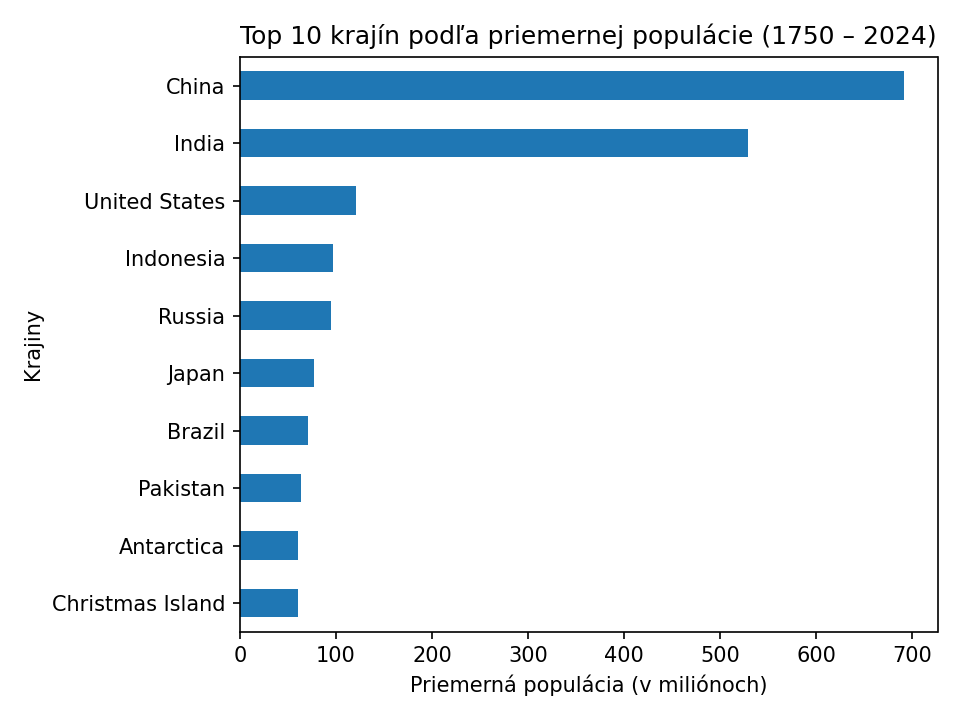
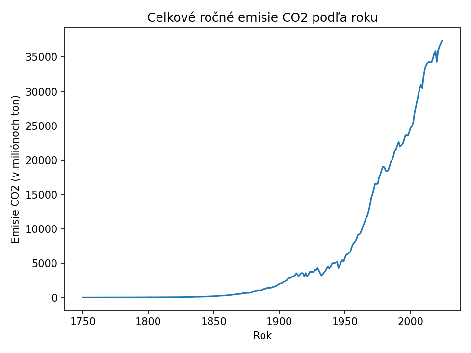
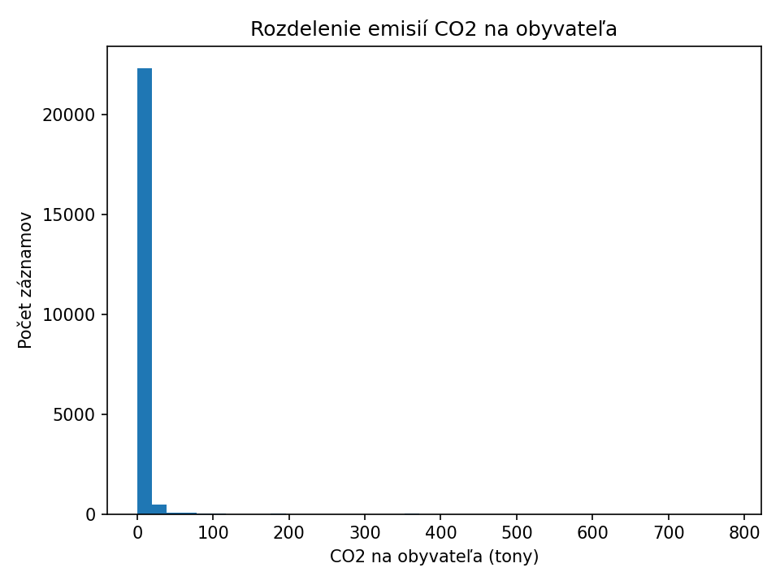

# Analýza populácie a CO2 emisií

Načítané riadky: 42480
Zdroj - OWID CO2 dataset

## Top 5 krajín podľa populácie

```
                       mean  count
country                           
China          6.919765e+08    175
India          5.292500e+08    175
United States  1.206562e+08    225
Indonesia      9.717433e+07    175
Russia         9.535850e+07    179
```

## Grafy







## Zistenia

- China má najvyššiu priemernú populáciu spomedzi všetkých krajín, 1.3x viac ako druhá India.
- V roku 2024 vyprodukovali krajiny v datasete spolu 37,398 miliónov ton CO2.
- Top 5 krajín podľa populácie tvorí 36.7% priemernej populácie všetkých krajín v datasete.

## Dáta

Zdroj: [OWID CO2 dataset](https://github.com/owid/co2-data) (Our World in Data).
42,480 riadkov po vyčistení, roky 1750–2024, 218 krajín. Vstupný súbor `data_cisté.csv` (nie je v repozitári, pozri nižšie).

## Ako to spustiť

```
pip install -r requirements.txt
python analyza2.py
```

`data_cisté.csv` nie je v repozitári (je príliš veľký). Priprav si ho takto:

```python
import pandas as pd
co2_data = pd.read_csv("owid-co2-data.csv")
co2_data["population"] = co2_data["population"].fillna(co2_data["population"].mean())
co2_data_ciste = co2_data.dropna(subset=["iso_code"])
co2_data_ciste.to_csv("data_cisté.csv", index=False)
```

Surový CSV: https://raw.githubusercontent.com/owid/co2-data/master/owid-co2-data.csv

## Štruktúra

- `analyza2.py` — načítanie, čistenie, agregácie, grafy a README, jedným spustením
- `data_cisté.csv` — vstupné dáta (treba vyrobiť, pozri vyššie)
- `vystupy/` — výstupné PNG grafy a `agregacia.csv` (generované skriptom)

## Čo by som dorobil

- Rozdelenie CO2 emisií podľa zdroja (uhlie, ropa, plyn) — dataset ich má, nevyužil som ich.
- Argument pri spustení na vlastnú cestu k CSV namiesto pevného mena súboru.
